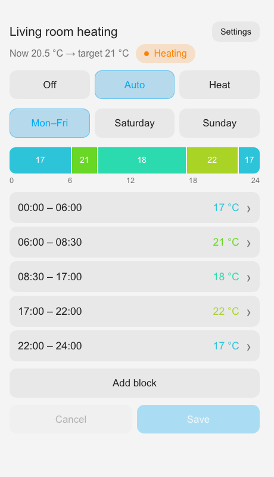
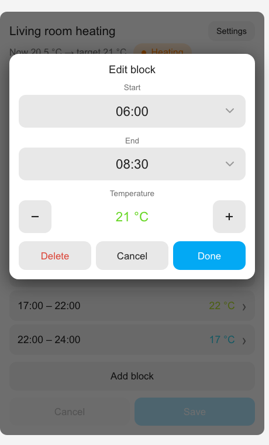

# Thermostat Schedule Card

A touch-friendly Lovelace card for editing the **weekly heating schedule** of Zigbee2MQTT thermostats that expose the schedule as `text` entities – developed for the **Sonoff WGZBA**.



- timeline bar and block list, tap a block to edit start / end / temperature
- grouped days (Mon–Fri / Sat / Sun), every day separately, or one plan for all days
- HVAC mode switch (Off / Auto / Heat), current → target temperature, heating state
- optional panel settings (presence radar, sensitivity, brightness) for the WGZBA
- visual editor, English and Czech (follows the Home Assistant language)



## How it works

The thermostat keeps its schedule itself; the card only reads and writes the Zigbee2MQTT `text` entities `text.<name>_weekly_schedule_<day>` (`monday` … `sunday`), whose value looks like

```
00:00/17 06:00/21 08:30/18 17:00/22 22:00/17
```

(`HH:MM/°C`, the first block must start at 00:00, at most 12 blocks per day by default). The schedule only applies when the thermostat is in **Auto** mode.

Other Zigbee2MQTT thermostats using the same text format should work, but only the WGZBA is tested.

## Installation

### HACS (custom repository)

1. HACS → ⋮ → *Custom repositories* → add `https://github.com/myreczek/thermostat-schedule-card`, category **Dashboard** (plugin).
2. Install *Thermostat Schedule Card* and reload the browser.

### Manual

1. Copy `thermostat-schedule-card.js` to `/config/www/`.
2. *Settings → Dashboards → ⋮ → Resources* → add `/local/thermostat-schedule-card.js` as **JavaScript module**. Bump `?v=N` after every update to bypass the browser cache.

## Configuration

Add the card from the card picker and use the visual editor, or in YAML:

```yaml
type: custom:thermostat-schedule-card
climate: climate.livingroom_heating
```

The schedule entities are derived from the climate entity (`climate.foo` → `text.foo_weekly_schedule_<day>`).

| Option | Default | Description |
|---|---|---|
| `climate` | – | Thermostat entity (current/target temperature, mode switch). Required unless `entity_prefix` is set |
| `entity_prefix` | derived from `climate` | Prefix of the schedule entities, e.g. `text.livingroom_heating_weekly_schedule_` |
| `title` | *Heating schedule* | Card title |
| `grouping` | `workdays` | `workdays` (Mon–Fri / Sat / Sun), `daily` (7 tabs) or `all` |
| `min` / `max` | `5` / `30` | Allowed temperature range |
| `step` | `0.5` | Temperature step |
| `time_step` | `15` | Time step in minutes (divisor of 60) |
| `max_blocks` | `12` | Maximum blocks per day (device limit) |
| `cold` / `warm` | `16` / `24` | Temperatures at the ends of the blue → orange colour scale |
| `language` | Home Assistant language | `en` or `cs` |
| `radar_entity` | `switch.<climate>_radar_detection` | WGZBA presence detection switch |
| `sensitivity_entity` | `select.<climate>_radar_sensitivity` | WGZBA radar sensitivity |
| `brightness_entity` | `number.<climate>_active_brightness` | WGZBA active display brightness |

The *Settings* button appears only when at least one of the radar entities exists.

## Development

```sh
npm test        # smoke test with a stubbed DOM, no browser needed
```

Translations live in the `STRINGS` object at the top of `thermostat-schedule-card.js` – pull requests with more languages are welcome.

## License

MIT
